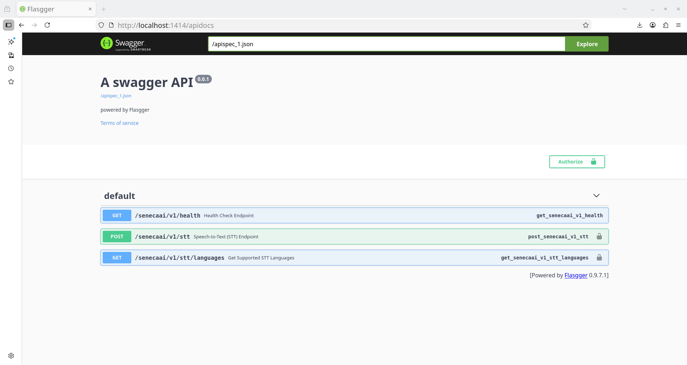

# Seneca AI: Docker containers

Seneca uses Docker containers to run the various services that make up its architecture

> [**Docker**](https://www.docker.com/) is a platform designed to help developers build, share, and run container applications. 
> It handle the tedious setup, so you can focus on the code.

## Ollama container

Container that runs [Ollama](https://ollama.com/), a free open-source tool that allows you to install and run 
artificial intelligence models (such as Llama 3, DeepSeek or Gemma) directly on your own computer. 
Instead of relying on cloud services like ChatGPT, it processes everything locally.

The AI model/s installed depends on the hardware available in your PC/laptop and the user choice.
These are the models suggested during the installation:

| Detected RAM | Tier  | GPU | AI model                     |
|--------------|-------|-----|------------------------------|
| < 15 GB      | 8 GB  | No  | qwen2.5:1.5b or llama3.2:1b  |
| < 15 GB      | 8 GB  | Yes | qwen2.5:3b or qwen2.5:1.5b   |
| 15 - 30 GB   | 16 GB | No  | qwen2.5:3b or llama3.2:3b    |
| 15 - 30 GB   | 16 GB | Yes | mistral:7b or llama3:8b      |
| 31 - 62 GB   | 32 GB | No  | llama3:8b or gemma2:9b       |
| 31 - 62 GB   | 32 GB | Yes | qwen2.5:14b or phi3:14b      |
| >= 63 GB     | 64 GB | No  | llama3:8b or command-r:35b   |
| >= 63 GB     | 64 GB | Yes | mixtral:8x7b or llama3.1:70b |

Each tier starts 1 GB below its size, because the operating system reports a
bit less RAM than the installed RAM (e.g. a 32 GB computer may report 31 GB).
The selection scripts are `select_ollama_model.sh` (Linux) and
`select_ollama_model.ps1` (Windows).

The container pulls and serves the model set in `OLLAMA_MODEL`. The
installer always stores it in `.env`:

1. If `OLLAMA_MODEL` already has a value in `.env`, it is kept and nothing is
   asked.
2. Otherwise, if `OLLAMA_MODEL` is set as an environment variable, it is
   written to `.env` and nothing is asked.
3. Otherwise the installer suggests two models from the table above and
   writes the chosen one to `.env`.

To change the model later, edit `OLLAMA_MODEL` in `.env` and run
`docker compose up -d`. Note that docker compose gives precedence to the
environment: an `OLLAMA_MODEL` exported in the shell that runs
`docker compose` wins over `.env`. If neither sets it, the default is
`hadad/LFM2.5-1.2B:Q4_K_M`.

## API container

Container that exposes a REST API used by Seneca AI:

 - `GET` **/senecaai/v1/health** Health Check Endpoint
 - `POST` **/senecaai/v1/stt** Speech-to-Text (STT) Endpoint
 - `GET` **/senecaai/v1/stt/languages** Get Supported STT Languages
 - `POST` **/senecaai/v1/auth/login**, **/auth/refresh**, **/auth/logout** Authentication (JWT)
 - `POST` **/senecaai/v1/chat** Send a message and stream the reply (Server-Sent Events)
 - `GET` **/senecaai/v1/chat/capabilities** LLM provider, model and tool-calling support
 - `GET`, `POST` **/senecaai/v1/conversations** List / create conversations
 - `GET`, `PATCH`, `DELETE` **/senecaai/v1/conversations/{id}** Get / update / delete a conversation
 - `POST` **/senecaai/v1/conversations/{id}/messages** Append messages to a conversation

A Postman collection with all the methods is available in `assets/api/Seneca AI.postman_collection.json`.

The API calls the chat LLM (the desktop app only talks to the API). The
container takes `LLM_PROVIDER`, the model names and the OpenAI/Anthropic keys
from the host `.env`. Apply changes with `docker compose up -d`. See
[chat-api.md](chat-api.md).

The faster-whisper model is downloaded from Hugging Face on the first start and
kept in the `huggingface_cache` volume (`/opt/senecaai/volumes/huggingface`,
or `HF_CACHE_PATH`), so rebuilding or re-creating the container does not
download it again.

### Network and VPNs

All the containers share the `llm_net` network. If the host reaches the
Internet through a VPN whose MTU is smaller than Docker's default of 1500 (for
example 1280 for WireGuard VPNs such as Surfshark), the larger packets are
silently dropped. HTTPS connections from the containers then hang: the TLS
handshake never finishes, while plain HTTP and small requests still work. The
Whisper model download is the first thing to fail.

Set the VPN's MTU (`ip link` shows it on the VPN interface) in `.env` and
re-create the network:

```bash
# .env
DOCKER_NETWORK_MTU=1280

docker compose down && docker compose up -d   # volumes (data, models) are kept
```

### Secrets

The containers receive their secrets as Docker secrets (files mounted in `/run/secrets`).
**None of these files is versioned.** `generate_secrets.sh` (Linux) and `generate_secrets.ps1`
(Windows) create the missing ones with random values. The install and redeploy scripts
(`install-ubuntu.sh`, `install-win.ps1`, `redeploy.sh`, `redeploy.bat`) call them automatically.

| Secret                     | Host file                               | Generated value / notes                                          |
|----------------------------|-----------------------------------------|------------------------------------------------------------------|
| `seneca_ai_api_key_secret` | `docker/api/seneca_ai_api_key.txt`      | 48 hex characters. Value expected in the `X-SENECA-AI-API-KEY` header. Also copied to `SENECA_AI_API_KEY` in `.env` for the desktop app |
| `jwt_secret_key`           | `docker/api/jwt_secret_key.txt`         | 64 hex characters. Signs the JWT tokens                          |
| `mongo_root_username`      | `docker/mongo/mongo_root_username.txt`  | `senecaai_admin`. MongoDB root user (authenticated against `admin`) |
| `mongo_root_password`      | `docker/mongo/mongo_root_password.txt`  | 48 hex characters. MongoDB root password                         |

To create them by hand, run from the project root:

```bash
./generate_secrets.sh                                                       # Linux
powershell -NoProfile -ExecutionPolicy Bypass -File generate_secrets.ps1   # Windows
```

> **Existing secrets are never overwritten.** MongoDB only applies the root user and
> password the first time it starts with an **empty** data directory
> (`/opt/senecaai/volumes/mongo`). If you delete or change the Mongo files while the
> database already has data, the `api` container can no longer connect. To change the
> password, change it in MongoDB first (`db.changeUserPassword(...)` in the `admin`
> database) and then update the file. Regenerating the JWT secret logs every user out.
>
> On Linux, the Mongo files are created with mode `644` because the `mongo` image reads
> them as the `mongodb` user, not as root. The API files use mode `600`.

> **First start and VPNs:** on its first start the API container downloads the Whisper
> model from Hugging Face. VPNs with a small MTU (e.g. WireGuard, MTU 1280) can make the
> HTTPS downloads from the Docker bridge network hang, and the API never opens port 1414.
> Disconnect the VPN during the first start.

To see the Swagger API documentation, access to [http://localhost:1414/apidocs](http://localhost:1414/apidocs)
when Seneca AI is running:



## Qdrant and memory-worker containers

`qdrant` is a vector database with an index of the user's past conversations,
and `memory-worker` (same image as `api`) keeps it up to date from MongoDB.
The API searches it to give the chat long-term memory. Neither publishes a
port. See [memory.md](memory.md).

## MongoDB container (Coming soon)

Container that runs MongoDB to maintain the historic of chats between Seneca AI and the user.

> **What is MongoDB?**
> 
> MongoDB is a document database that offers high scalability and flexibility, 
> as well as an advanced query and indexing model.